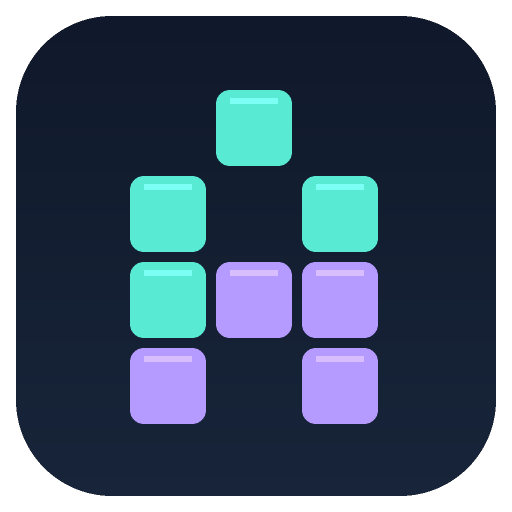
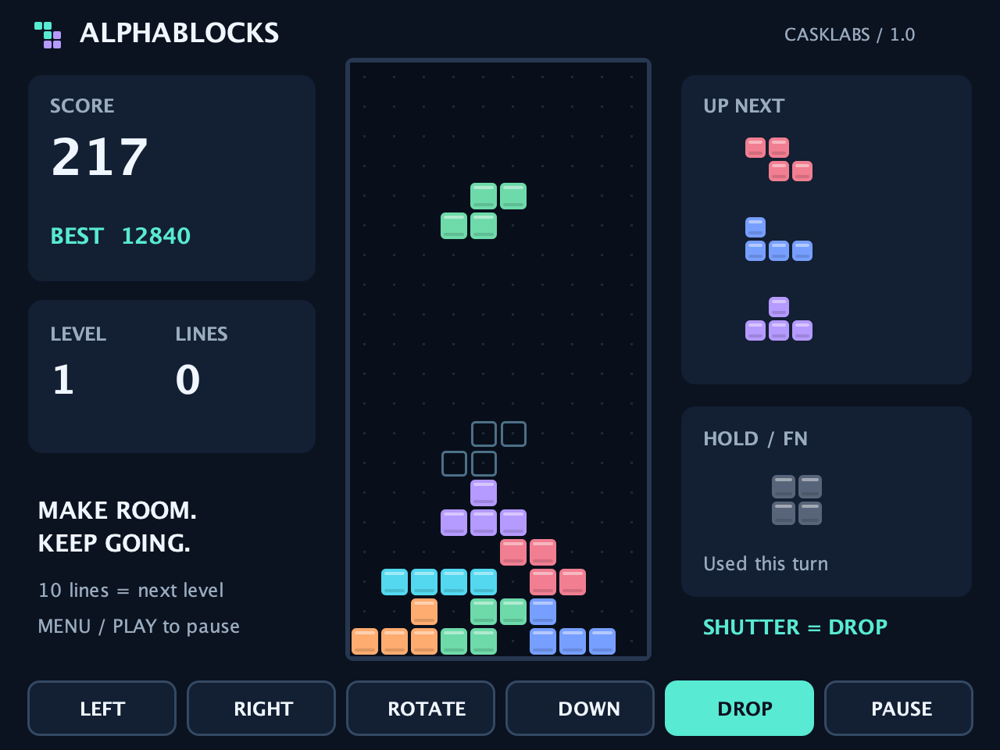
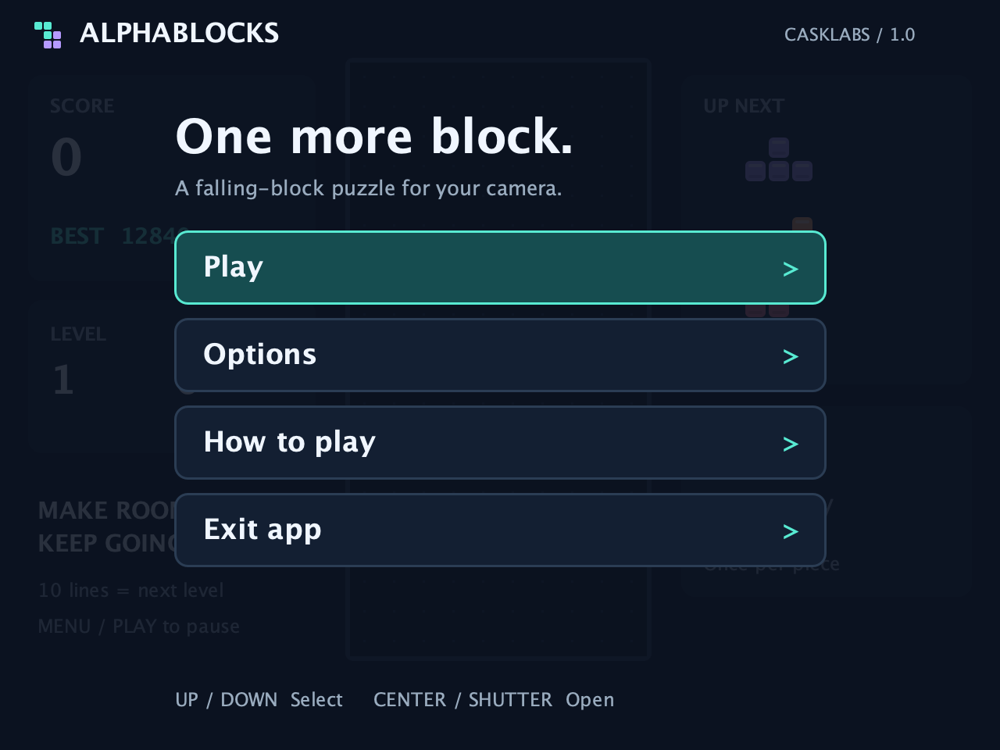

<p align="center"></p>

# AlphaBlocks

A falling-block puzzle for Sony PlayMemories Camera Apps (PMCA) cameras, by CaskLabs.
Move, rotate and drop seven colorful pieces, clear rows and beat your high score — using the camera's own buttons.



## Download and install

Download **AlphaBlocks-v1.0.0.apk** from [Releases](https://github.com/CaskLabs/AlphaBlocks/releases/latest)
and sideload it using [Sony-PMCA-RE](https://github.com/ma1co/Sony-PMCA-RE).
The APK uses package `com.casklabs.alphablocks` and can be installed alongside GhostBuffer.
Release APKs are debug-signed for sideloading.

AlphaBlocks targets PMCA's Android 2.3.3 / API 10 environment. It is designed around the
Sony α5000's landscape display and controls, but **this first version has not yet been tested
on a physical camera**. Other PMCA models may work; compatibility is not confirmed.

## Features

- A 10 × 20 playfield, seven-bag randomization and three-piece preview.
- Clockwise rotation with wall and floor kicks; a 500 ms lock delay with a reset limit.
- Hold / swap once per piece and an optional landing guide.
- Soft drop and instant hard drop with drop points.
- Increasing speed every ten cleared lines and starting levels 1–15.
- Persistent high score and settings, pause menu and an in-app control guide.
- Automatic pause when the app loses focus or goes into the background.
- Uniformly scaled full-screen layout, clickable controls and an original app icon.

No camera capture, SD-card access, network connection or Android permissions are required.
The current board stays available while the activity remains alive; it is not restored after
the process exits. High score and settings are stored internally on the camera.

## Camera controls

| Button | During play |
| --- | --- |
| Left / right | Move; hold to repeat |
| Up / center | Rotate clockwise |
| Down | Soft drop; hold to repeat |
| Full shutter press | Hard drop and lock |
| Fn / AEL, if present | Hold / swap piece |
| Play / Menu | Pause; press again to resume from the pause menu |
| Delete | Pause; return from submenus |

Half-pressing the shutter is consumed without dropping a piece. In menus, use up/down to select
and center or shutter to open. Change options with left/right. Exit using **Exit app** on the main menu.

All menu rows and bottom gameplay buttons are clickable on devices with a touchscreen or pointer.
Tap the **Hold / Fn** panel to hold a piece. A keyboard can also use arrow keys or WASD,
Enter to rotate/select, Space to drop, C to hold and P to pause.

## Scoring

| Rows cleared at once | Points × current level |
| --- | ---: |
| 1 | 100 |
| 2 | 300 |
| 3 | 500 |
| 4 | 800 |

Soft drop adds one point per cell; hard drop adds two. Gravity alone adds no points.
Every ten cleared rows increases the level by one. Starting-level changes apply to the next game;
the landing guide can be changed during a paused game.

## Build

Use **JDK 8**, **Android SDK platform 10** and **build tools 25.0.2**.
The Gradle wrapper uses **2.14.1** with Android Gradle Plugin **2.2.3** to support the camera's older runtime.
Dependencies are resolved from Maven Central, a legacy JCenter mirror and JitPack.

```sh
export JAVA_HOME=/path/to/jdk8
export PATH="$JAVA_HOME/bin:$PATH"
export ANDROID_HOME=/path/to/android-sdk
./gradlew --no-daemon --console plain testDebugUnitTest lintDebug assembleDebug
```

The signed installable APK is written to:

```text
app/build/outputs/apk/AlphaBlocks-1.0.0-debug.apk
```

For an APK update, retain the same signing key. The standard Android debug keystore is local to
the build machine and is not part of this repository.

## Tests and previews

The Android-independent engine and navigation have **41 unit tests**, including line clears,
scoring, collisions, kicks, hold restrictions, lock delay, game-over, random action sequences,
controlled key repetition, lifecycle pause, menu navigation and clickable targets.

Run them without an Android SDK using JDK 8, Python 3 and curl:

```sh
./scripts/test.sh
```

GitHub Actions runs the same suite. Android compilation and lint are additional local build checks.
Hardware input routing, PMCA display behavior and on-camera performance still need a physical camera test.

The images in `docs/` are **desktop renders of the same Java scene used in the APK**, not camera screenshots.
Regenerate them with a desktop JDK:

```sh
./scripts/preview.sh
python3 scripts/generate_icon.py
```



## License and credits

MIT. See [LICENSE](LICENSE) and [THIRD_PARTY_NOTICES.md](THIRD_PARTY_NOTICES.md).
Camera integration uses [OpenMemories-Framework](https://github.com/ma1co/OpenMemories-Framework)
and follows the PMCA lifecycle pattern from [PMCADemo](https://github.com/ma1co/PMCADemo).
AlphaBlocks is an independent falling-block game with original artwork.
